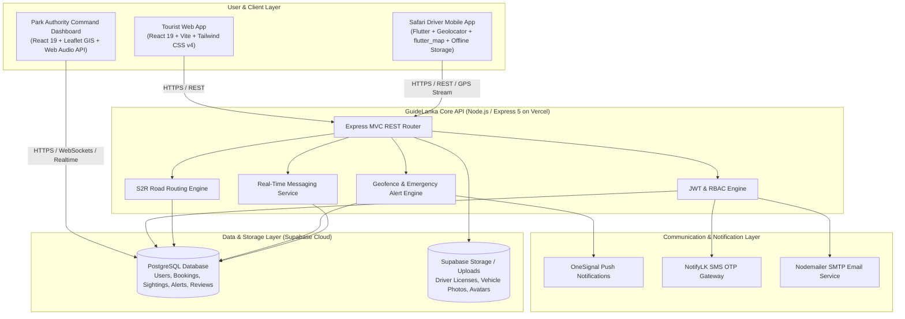

# 🌿 GuideLanka — Smart National Park & Wildlife Safari Management System

<div align="center">

[](https://guide-lanka-backend.vercel.app)
[](https://nodejs.org/)
[](https://expressjs.com/)
[](https://react.dev/)
[](https://flutter.dev/)
[](https://supabase.com/)
[](https://tailwindcss.com/)
[](https://leafletjs.com/)

<p align="center">
  <b>A unified, real-time ecosystem modernizing Sri Lanka's wildlife safari operations.</b><br>
  Connecting Tourists, Safari Drivers, and Department of Wildlife Conservation (DWC) Authorities through real-time GIS telemetry, offline-resilient field navigation, AI-assisted Sightings-to-Route (S2R) trail optimization, instant emergency response with direct calling, and verified bookings.
</p>

[Key Features](#-key-features) •
[System Architecture](#-system-architecture) •
[S2R Routing Algorithm](#-s2r-sightings-to-route-algorithm) •
[System Modules](#-system-modules) •
[Repository Structure](#-repository-structure) •
[Tech Stack](#-technology-stack) •
[Installation & Setup](#-installation--setup-guide) •
[Mobile APK Build](#-mobile-apk-build-guide) •
[API Reference](#-api-endpoints-reference) •
[Conservation Standards](#-security--conservation-standards)

---

</div>

## 📖 Overview

National Parks in Sri Lanka (including **Yala**, **Wilpattu**, **Udawalawe**, and **Minneriya**) host some of the planet's densest populations of leopards, Asian elephants, and endemic wildlife. However, traditional safari management faces severe operational and conservation bottlenecks:

- **Track Congestion & Animal Stress**: Sudden wildlife sightings trigger vehicle rushes, causing track gridlocks and alarming vulnerable fauna.
- **Safety & Geofence Breaches**: Jeeps inadvertently venturing into strict natural reserves or restricted core conservation zones without real-time boundary warnings.
- **Driver Verification Gaps**: Tourists struggle to distinguish certified, licensed guides with standardized commercial rates and safety compliance.
- **Emergency Dispatch Latency**: Delayed ranger mobilization during breakdowns, lost routes, medical emergencies, or dangerous animal encounters—especially in deep jungle regions with patchy mobile connectivity.

**GuideLanka** addresses these challenges through a synchronized four-tier architecture powered by real-time GPS tracking, offline-first mobile sync, multi-channel push/SMS alerts, and mathematically optimized trail dispatching.

---

## ✨ Key Features

- **🧠 Sightings-to-Route (S2R) Algorithm**: Calculates dynamic safari paths along real park tracks using species-specific behavioral decay, congestion penalties, and Dijkstra graph pathfinding.
- **📶 Offline-First Mobile Resilience**: Caches sightings and SOS signals locally via `SharedPreferences`, auto-syncing upon signal recovery, with an onboard directory of ranger stations, direct VHF radio channels, and compass bearings.
- **🛡️ Ranger Command Center**: Interactive Leaflet GIS dashboard rendering live jeep positions, active sightings, emergency siren audio alerts, 1-click driver phone calling (`tel:`), and Google Maps coordinate dispatch.
- **🌍 Tourist Discovery & Booking**: Full-featured web portal with wildlife heatmaps, certified driver search, tiered pricing (local vs. international), and live in-app messaging.
- **🚨 Instant Emergency SOS System**: Dedicated driver emergency trigger (`LOST_ROUTE`, `VEHICLE_BREAKDOWN`, `MEDICAL_EMERGENCY`, `ANIMAL_ENCOUNTER`) notifying park authorities via push notifications, SMS, and audio-visual sirens.
- **🔒 Role-Based Access Control (RBAC)**: Secure multi-tier authentication (`AUTHORITY`, `DRIVER`, `TOURIST`) backed by signed JWT tokens and encrypted database records.

---

## 🏛️ System Architecture



---

## 🧠 S2R (Sightings-to-Route) Algorithm

At the heart of GuideLanka's navigation engine is the **Sightings-to-Route (S2R)** algorithm. It models safari trail networks to maximize sighting probability while minimizing traffic congestion and off-track disturbance.

### 1. Species-Specific Time Decay ($TD_i$)
Different animals display vastly different territorial habits. Animal sightings decay dynamically based on behavioral half-life:

$$TD_i = \max\left(0, 1 - \frac{t_i}{T_{\max}(\text{species})}\right)$$

| Species | Max Lifespan ($T_{\max}$) | Behavioral Rationale | Animal Weight ($AW_i$) |
| :--- | :---: | :--- | :---: |
| 🐘 **Elephant** | **60 mins** | Foraging herds linger in feeding grounds and waterholes | `0.70` |
| 🐆 **Leopard** | **30 mins** | Solitary apex predator continuously patrolling territory | `1.00` |
| 🐻 **Sloth Bear** | **30 mins** | Solitary omnivore roaming between termite mounds & fruit trees | `0.80` |
| 🦚 **Peacock / Birds** | **20 mins** | High flight mobility and rapid relocation | `0.20` |
| 🦌 **Deer / Sambar** | **15 mins** | Alert herbivores that scatter upon engine noise | `0.30` |

### 2. Sighting Utility ($S_i$)
Quantifies the observational value of a reported sighting based on species weight, temporal freshness, and observer reliability ($R_i \approx 0.90$):

$$S_i = AW_i \times TD_i \times R_i$$

### 3. Safari Road Graph Network & Dijkstra Routing
* Road networks are ingested from detailed park GeoJSON vector coordinates (such as the authentic **Yala Block 5 & 6** topology with over 4,600 nodes).
* Disconnected road segments and trail junctions are bridged dynamically using a 15-meter proximity threshold (`_ensureFullyConnected()`).
* Dijkstra’s shortest-path algorithm calculates curved trajectories along verified safari roads, preventing cross-country vector shortcuts across fragile vegetation.

### 4. Overall S2R Route Score ($U_i$)
Calculates composite utility balancing wildlife excitement against congestion and travel distance:

$$U_i = w_s S_i - w_c C_i - w_d D_i$$

Where:
* $w_s = 0.5$ (Sighting utility weight)
* $w_c = 0.3$ (Congestion penalty weight)
* $w_d = 0.2$ (Normalized road distance weight)

---

## 🚀 System Modules

### 1. 🛡️ Park Authority Command Dashboard (`/authority-dashboard`)
Dedicated command hub for Department of Wildlife Conservation (DWC) rangers and wardens:
* **Interactive Live Operations GIS Map**: Leaflet map visualizing real-time positions of safari jeeps, active animal sightings, and authentic Yala Block 5 & 6 GeoJSON road vectors with popup route details.
* **Emergency (SOS) Command Center**:
  * Real-time audible siren via Web Audio API when emergencies are broadcast.
  * Direct click-to-call link (`tel:<driver_phone>`) to contact the jeep operator immediately.
  * 1-click **"View on Maps"** external coordinate pin for quick ranger dispatch.
  * Multi-state incident progression tracking (`PENDING` ➔ `INVESTIGATING` ➔ `RESOLVED`).
* **Geofence Enforcement**: Automated visual and auditory warnings triggered when vehicles stray outside authorized safari sectors.
* **Driver Compliance Directory**: Inspection of driver identity records, commercial safari licenses, vehicle registrations, and tourist ratings.
* **Tourist Demographics & Analytics**: Visual charts tracking visitor nationalities, peak safari booking slots, and passenger volumes.
* **Revenue & Commission Tracker**: Real-time calculation of park entry fees, daily active safaris, and monthly revenue metrics.
* **Reports & Analysis**: Comprehensive incident history, animal distribution logs, and exportable patrol summaries.

### 2. 📱 Safari Driver Mobile App (`/driver_mobile`)
Built in Flutter (Dart 3) for rugged field reliability in low-connectivity wilderness:
* **Turn-by-Turn S2R Trail Navigation**: Neon-blue illuminated route overlays following authentic park curves.
* **Offline-First Resilience**:
  * Queues sighting logs and SOS alerts locally using `SharedPreferences` when offline.
  * Automatically pushes queued records to the server when cellular connection is restored.
* **DWC Ranger Station Directory & VHF Radio Guide**:
  * Offline-accessible registry of key ranger posts: **Galge HQ**, **Katagamuwa Post**, **Kebiliththa Camp**, and **Palatupana Warden HQ (`1992`)**.
  * Calculates live distance in kilometers and compass bearing (`N`, `NE`, `E`, `SE`, `S`, `SW`, `W`, `NW`) from current GPS coordinates.
  * Lists emergency VHF two-way radio channels (Ch 08, Ch 12, Ch 16) for zero-cellular conditions.
* **1-Tap Emergency SOS Transmitter**: Sends GPS coordinates, breakdown type, and timestamp directly to ranger headquarters.
* **Interactive Sighting Logger**: Tap or drag pins on the map to log animal encounters with species tags and countdown lifespan badges.
* **Reservation Coordination**: Accept or decline incoming tourist bookings and communicate via built-in chat.

### 3. 🌍 Tourist Web Experience (`/tourist-web-app`)
Responsive traveler portal built with React 19 and Tailwind CSS v4:
* **Wildlife Explorer & Heatmap (`/map`)**: Interactive map displaying recently verified wildlife sightings and density hotspots across park zones.
* **Certified Driver Directory (`/drivers`)**: Filterable directory of verified drivers featuring ratings, verified badges, vehicle details, spoken languages, and pricing.
* **Direct Safari Booking (`/booking`)**: Reservation flow supporting morning, evening, and full-day tours with dynamic local and foreign pricing models.
* **Real-Time Driver Chat (`/chat/:bookingId`)**: Direct chat channel between tourist and assigned safari driver.
* **Park Safety Manual & Guidelines (`/rules`)**: Visual ethical guide covering vehicle etiquette, waste management, photography rules, and wildlife distance requirements.
* **Wildlife Gallery & FAQ (`/gallery`, `/faq`)**: Curated wildlife photography, safari planning advice, and national park visitor policies.

### 4. ⚙️ Central Cloud API (`/backend`)
* **Production Deployment**: Hosted on Vercel at [`https://guide-lanka-backend.vercel.app`](https://guide-lanka-backend.vercel.app).
* **RESTful MVC Architecture**: Scalable controllers, middlewares, routes, and services built with Express 5 on Node.js v20+.
* **Database & Auth**: Supabase PostgreSQL integration with JWT-authenticated RBAC.
* **Multi-Channel Dispatch**: Automated SMS OTP delivery (NotifyLK), push notifications (OneSignal), and transactional emails (Nodemailer).

---

## 📂 Repository Structure

```
GuideLanka/
├── 📁 authority-dashboard/           # Ranger Command Center (React 19 + Vite)
│   ├── 📁 src/
│   │   ├── 📁 assets/                # GeoJSON road networks & branding assets
│   │   ├── 📁 components/            # LiveMap, SOSPanel, RouteConfig, RevenueTracker,
│   │   │                             # TouristAnalytics, DriverReviewList, ReportsAnalysis
│   │   ├── 📁 pages/                 # Dashboard, Login
│   │   └── 📁 services/              # Supabase client & API configuration
│   ├── package.json
│   └── vite.config.js
│
├── 📁 backend/                       # Central Express 5 REST API
│   ├── 📁 src/
│   │   ├── 📁 config/                # Supabase client & environment configuration
│   │   ├── 📁 controllers/           # Auth, Alert, Booking, Driver, Route, Sighting, User
│   │   ├── 📁 middlewares/           # JWT auth & role validation (authMiddleware, roleMiddleware)
│   │   ├── 📁 routes/                # authRoutes, alertRoutes, bookingRoutes, chatRoutes,
│   │   │                             # driverRoutes, routeRoutes, sightingRoutes, userRoutes
│   │   ├── 📁 services/              # S2R routing engine & mathematical optimization
│   │   └── 📁 utils/                 # Email sender (Nodemailer), SMS sender (NotifyLK)
│   ├── server.js                     # Server entry point
│   ├── vercel.json                   # Vercel serverless deployment config
│   └── package.json
│
├── 📁 driver_mobile/                 # Flutter Field Navigation App
│   ├── 📁 android/                   # Native Android manifest & launcher icons
│   ├── 📁 assets/                    # Yala GeoJSON tracks, app icons, logos
│   ├── 📁 lib/
│   │   ├── 📁 screens/               # SafariMap, Login, Home, SOS, Chat, Profile, History
│   │   ├── 📁 services/              # S2RRoutingService (Dijkstra), OfflineStorageService, ApiService
│   │   └── 📁 widgets/               # Theme constants, action cards, status badges
│   └── pubspec.yaml                  # Flutter package dependencies & asset declarations
│
├── 📁 tourist-web-app/               # Tourist Web Portal (React 19 + Vite)
│   ├── 📁 src/
│   │   ├── 📁 assets/                # Wildlife showcases, park safety icons, banners
│   │   ├── 📁 components/            # Auth modal, booking form, driver cards, live map, navbar, footer
│   │   ├── 📁 pages/                 # Home, DriversList, BookingPage, MapPage, ParkRules,
│   │   │                             # DriverProfile, ChatPage, Gallery, FaqPage, AboutPage
│   │   └── 📁 services/              # API and Supabase client bindings
│   ├── package.json
│   └── vite.config.js
│
└── README.md                         # Comprehensive documentation
```

---

## 🛠️ Technology Stack

| Domain | Technology / Library | Purpose |
| :--- | :--- | :--- |
| **Backend Runtime** | Node.js (v20+), Express.js (v5.x) | RESTful MVC architecture deployed on Vercel |
| **Database & Auth** | Supabase (PostgreSQL), JWT, Bcrypt | Relational storage, row security, RBAC tokens |
| **Authority Dashboard** | React 19, Vite, Tailwind CSS v4 | Ranger dispatch command center with Web Audio API alerts |
| **Tourist Web Portal** | React 19, Vite, Tailwind CSS v4 | Public safari discovery, booking, and wildlife map |
| **Mobile Application** | Flutter (Dart 3.x), `flutter_map`, `geolocator` | Rugged safari driver GPS navigation & offline syncing |
| **GIS & Mapping** | Leaflet, React-Leaflet, OpenStreetMap, GeoJSON | Authentic park tracks (Yala Block 5 & 6) and spatial calculation |
| **Push & Communications** | OneSignal, NotifyLK SMS, Nodemailer | Real-time emergency push, SMS OTP, and booking alerts |

---

## ⚡ Installation & Setup Guide

### Prerequisites
* **Node.js** (v18.x or v20+ recommended) & `npm`
* **Flutter SDK** (v3.10+ recommended) & **Android Studio**
* **Git**
* A **Supabase** project with PostgreSQL database

---

### 1. Clone the Repository
```bash
git clone https://github.com/umindudinal/GuideLanka-New.git
cd GuideLanka-New
```

---

### 2. Backend Setup (`/backend`)
```bash
cd backend
npm install
```

Create a `.env` file in `/backend`:
```env
PORT=5000
SUPABASE_URL=https://your-supabase-project.supabase.co
SUPABASE_KEY=your-supabase-service-role-or-anon-key
JWT_SECRET=your_jwt_secret_key

# SMS OTP Service (NotifyLK)
NOTIFY_API_KEY=your_notifylk_api_key
NOTIFY_USER_ID=your_notifylk_user_id
NOTIFY_SENDER_ID=your_sender_id

# Push Notifications (OneSignal)
ONESIGNAL_APP_ID=your_onesignal_app_id
ONESIGNAL_REST_API_KEY=your_onesignal_rest_key

# Email Service (SMTP / Google App Password)
SMTP_HOST=smtp.gmail.com
SMTP_PORT=587
SMTP_USER=your_email@gmail.com
SMTP_PASS=your_16_character_app_password
```

> 💡 **SMTP Tip:** If using Gmail, enable **2-Step Verification** and generate a 16-character **App Password** (`Security > App Passwords`). If SMTP authentication fails during local development, the backend automatically logs OTP verification codes to the terminal console.

Start the backend:
```bash
npm run dev
# Server running on http://localhost:5000
```
> **Note:** The backend is also deployed live at `https://guide-lanka-backend.vercel.app`.

---

### 3. Authority Dashboard Setup (`/authority-dashboard`)
```bash
cd ../authority-dashboard
npm install
```

Configure `/authority-dashboard/.env` (optional for local override):
```env
VITE_API_BASE_URL=http://localhost:5000
VITE_SUPABASE_URL=https://your-supabase-project.supabase.co
VITE_SUPABASE_ANON_KEY=your-supabase-anon-key
```

Run locally:
```bash
npm run dev
# Dashboard available on http://localhost:5173
```
> ⚡ **Smart API Routing:** During `npm run dev`, API requests automatically default to the local backend (`http://localhost:5000`). In production builds, it seamlessly routes to the cloud backend (`https://guide-lanka-backend.vercel.app`).

---

### 4. Tourist Web App Setup (`/tourist-web-app`)
```bash
cd ../tourist-web-app
npm install
```

Configure `/tourist-web-app/.env` (optional):
```env
VITE_API_BASE_URL=http://localhost:5000
VITE_SUPABASE_URL=https://your-supabase-project.supabase.co
VITE_SUPABASE_ANON_KEY=your-supabase-anon-key
```

Run locally:
```bash
npm run dev
# Tourist portal available on http://localhost:5174
```

---

### 5. Driver Mobile App Setup (`/driver_mobile`)
```bash
cd ../driver_mobile
flutter pub get

# Launch on connected Android/iOS device or Chrome:
flutter run
```

---

## 📱 Mobile APK Build Guide

To compile an optimized production release APK for Android devices:

```bash
cd driver_mobile

# 1. Regenerate launcher icons (optional):
dart run flutter_launcher_icons

# 2. Build release APK:
flutter build apk --release
```

The compiled APK will be generated at:
```
driver_mobile/build/app/outputs/flutter-apk/app-release.apk
```

#### Transfer & Install:
1. Copy `app-release.apk` to your Android device via USB cable, Google Drive, or local file sharing.
2. Open the file on your device and tap **Install** (allow "Install Unknown Apps" in device settings if prompted).
3. The application connects directly to the live cloud backend (`https://guide-lanka-backend.vercel.app`), enabling instant testing over cellular data or Wi-Fi.

---

## 📡 API Endpoints Reference

### Authentication (`/api/auth`)
| Method | Endpoint | Description | Protected |
| :--- | :--- | :--- | :---: |
| `POST` | `/api/auth/register` | Register a new Tourist or Driver account | No |
| `POST` | `/api/auth/login` | Authenticate user credentials and return JWT | No |
| `POST` | `/api/auth/send-otp` | Dispatch SMS OTP verification code | No |
| `POST` | `/api/auth/verify-otp` | Verify phone number using OTP code | No |
| `POST` | `/api/auth/send-email-otp` | Dispatch email OTP code | No |
| `POST` | `/api/auth/change-password` | Update account password | Yes |
| `GET` | `/api/auth/check-authority` | Verify if park authority account exists | No |
| `POST` | `/api/auth/register-authority` | Register a new DWC authority administrator | No |

### Driver Management (`/api/driver`)
| Method | Endpoint | Description | Protected |
| :--- | :--- | :--- | :---: |
| `GET` | `/api/driver/profile` | Fetch authenticated driver profile | Yes |
| `PUT` | `/api/driver/profile` | Update driver profile details | Yes |
| `PATCH` | `/api/driver/status` | Toggle driver availability status | Yes |
| `POST` | `/api/driver/profile/picture`| Upload driver profile image | Yes |
| `GET` | `/api/driver/:driverId/reviews` | Retrieve ratings & reviews for a driver | No |
| `POST` | `/api/driver/:driverId/reviews` | Submit a tourist review for a driver | Yes |
| `PUT` | `/api/driver/:driverId` | Update driver record (Admin) | Yes |
| `DELETE` | `/api/driver/:driverId` | Delete driver account (Admin) | Yes |

### Wildlife Sightings (`/api/sightings`)
| Method | Endpoint | Description | Protected |
| :--- | :--- | :--- | :---: |
| `GET` | `/api/sightings` | Retrieve active time-decayed sightings | No |
| `POST` | `/api/sightings` | Log a new animal sighting with coordinates | Yes |

### Safari Bookings (`/api/bookings`)
| Method | Endpoint | Description | Protected |
| :--- | :--- | :--- | :---: |
| `POST` | `/api/bookings` | Create a new safari reservation (Tourist) | Yes (Tourist) |
| `GET` | `/api/bookings` | Retrieve user bookings (Tourist / Driver) | Yes |
| `PATCH` | `/api/bookings/:id/status` | Update booking status (`ACCEPTED`, `COMPLETED`, etc.) | Yes (Driver) |
| `PATCH` | `/api/bookings/:id/cancel` | Cancel booking reservation | Yes (Tourist) |

### S2R Route Optimization (`/api/routes`)
| Method | Endpoint | Description | Protected |
| :--- | :--- | :--- | :---: |
| `POST` | `/api/routes/optimize` | Compute optimal S2R route from current coordinates | Yes |

### Emergency & Alerts (`/api/alerts`)
| Method | Endpoint | Description | Protected |
| :--- | :--- | :--- | :---: |
| `POST` | `/api/alerts` | Log automated telemetry or geofence alert | Yes |
| `POST` | `/api/alerts/sos` | Dispatch emergency SOS alert to ranger command | Yes |
| `GET` | `/api/alerts` | Fetch list of active emergency alerts | Yes |

### Messaging & Chat (`/api/chat`)
| Method | Endpoint | Description | Protected |
| :--- | :--- | :--- | :---: |
| `GET` | `/api/chat/:booking_id` | Fetch conversation history for a booking | Yes |
| `POST` | `/api/chat/sendMessage` | Send a new chat message | Yes |
| `POST` | `/api/chat/markRead` | Mark messages as read | Yes |

---

## 🔒 Security & Conservation Standards

- **Geofence Safety Protocol**: Continuous coordinate boundary checking triggers automated audio and visual warnings when safari jeeps breach designated park trail perimeters.
- **Role-Based Access Control (RBAC)**: Fine-grained authorization separating `AUTHORITY`, `DRIVER`, and `TOURIST` actions via cryptographically signed JWT tokens.
- **Credential Protection**: User passwords are encrypted with salted `bcryptjs` hashing.
- **Wildlife Protection Focus**: Time-decayed sighting mechanics balance tourist wildlife viewing satisfaction with strict animal welfare standards, preventing vehicle swarming around endangered species.
- **Jungle Fail-Safe Architecture**: Offline caching and preloaded VHF radio frequencies guarantee driver emergency assistance even when cellular reception is unavailable.

---

## 👥 Contributors & Acknowledgements

Developed as an eco-tourism engineering initiative to advance sustainable wildlife safari management in Sri Lanka.

Special appreciation to:
- **Department of Wildlife Conservation (DWC), Sri Lanka** for park regulation guidelines and field insights.
- The safari driver community of **Yala National Park** for real-world navigation validation and operational feedback.

---

<div align="center">
  <sub>Built with ❤️ for Sri Lanka's Wildlife & National Parks.</sub>
</div>
